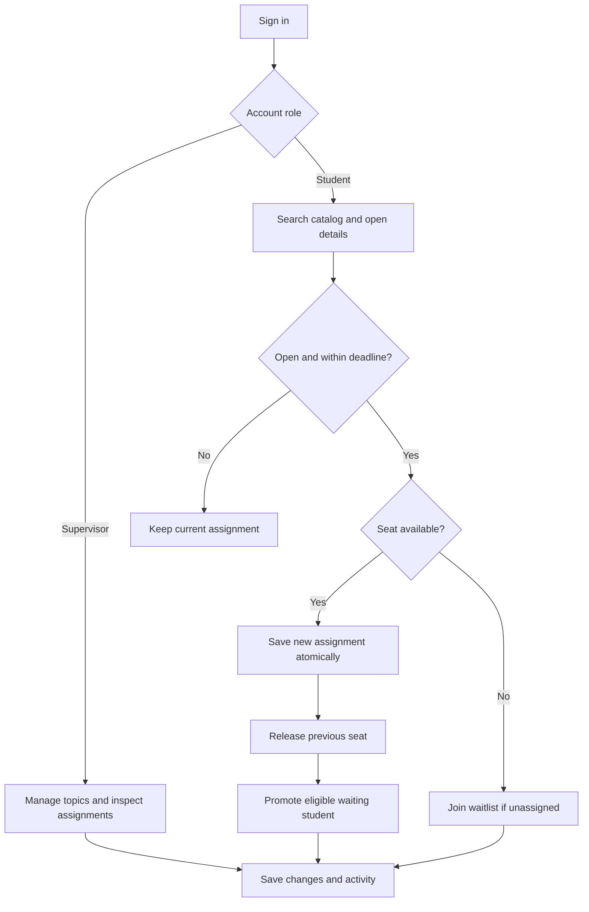
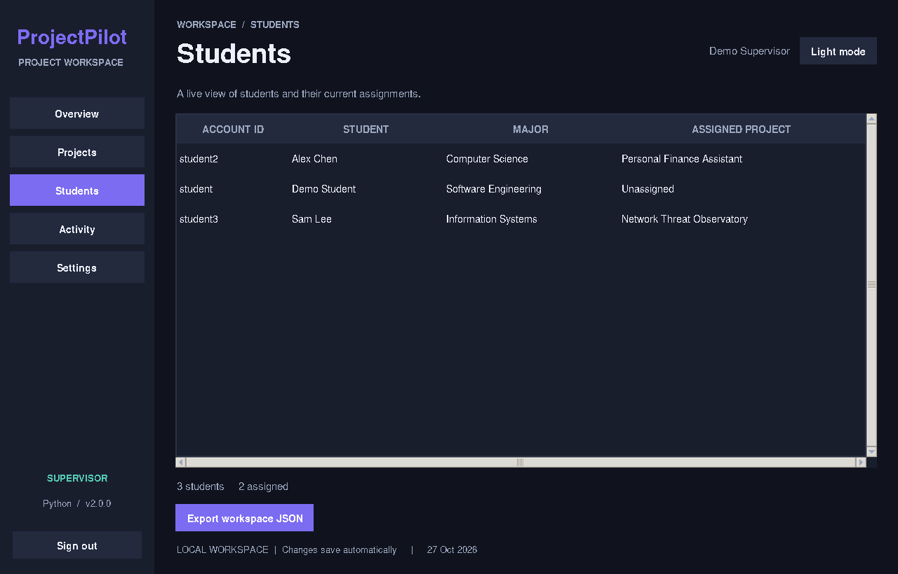
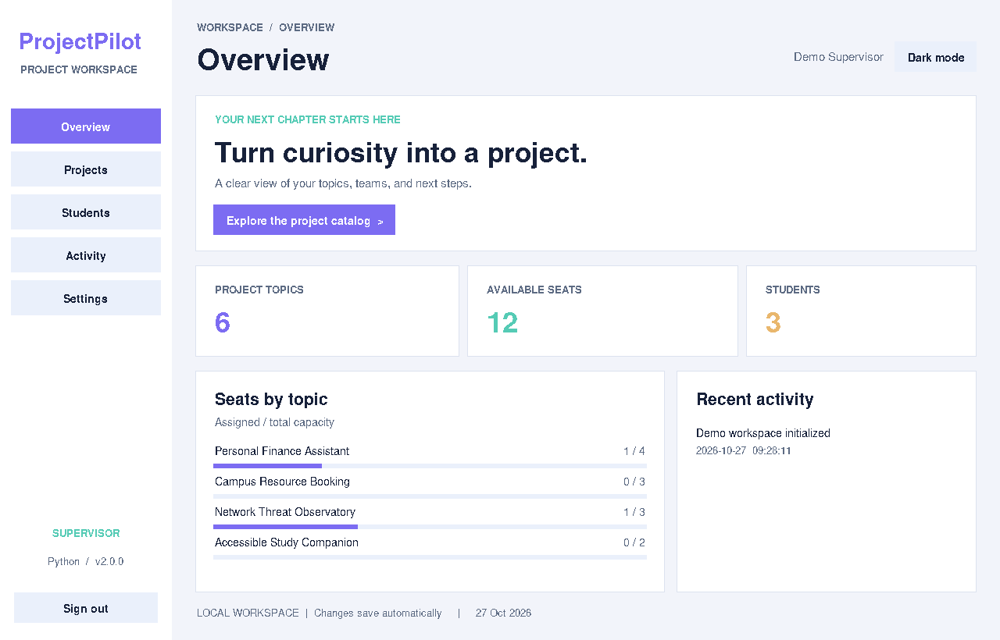
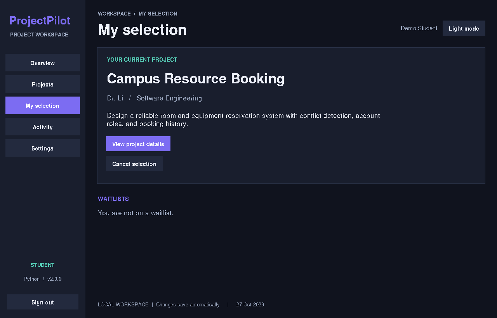

# ProjectPilot 2.0 — Python Edition

**Discover a topic. Find your team. Build your next chapter.**

Python 3.10+ · Tkinter · SQLite · Offline desktop

**Project history:** This project was originally written in **Java** as **ProjectSelectionManager**, using Swing and MySQL. It was then **converted to Python** and redesigned with Tkinter, SQLite, safer selection rules, and new features. This is a Python rewrite of the original workflows, not a Java wrapper.

Maintained for **MEAZBAH MEHEDI** · [GitHub](https://github.com/MeazbahMehedi)

## What this app does

A local desktop workspace for managing university project topics. Supervisors create topics and monitor assignments. Students discover topics, save favorites, select a project, or wait for a seat. All changes save automatically on this computer.

### Features

| Area | Included behavior |
| --- | --- |
| Interface | Sidebar navigation, dark/light themes, readable cards, resizable windows |
| Discovery | Live search across titles, supervisors, categories and descriptions; category filters; saved-topic filter |
| Tables | Sort by clicking a column heading; scrollable lists |
| Accounts | Student registration, individual sign-in, password changes, supervisor/student roles |
| Projects | Create, edit, delete; descriptions, categories, deadlines, Draft/Open/Closed states |
| Selection | One active project per student; atomic switching; capacity derived from assignments |
| Waitlists | Join/leave a full project's FIFO queue; auto-assign eligible students when a seat opens |
| Overview | Topic count, available seats, student/assignment summary, occupancy bars, recent activity |
| Reports | Supervisor student-assignment view; role-scoped activity timeline |
| Export | Project catalog as CSV; projects, permitted student records and activity as JSON |
| Backup | Supervisor-only workspace backup; manual restore instructions below |
| Shortcuts | `Ctrl+F` opens project search; `F5` refreshes the current view |

A student can see only their own student record and activity. Draft topics are supervisor-only. Registered users are always students; the included supervisor account is created by the app.

## Demo accounts

The app creates a fictional demo workspace only when no workspace exists.

| Role | Account ID | Password |
| --- | --- | --- |
| Supervisor | `teacher` | `DemoPass123!` |
| Student | `student` | `DemoPass123!` |
| Additional student | `student2` | `DemoPass123!` |
| Additional student | `student3` | `DemoPass123!` |

`student2` and `student3` start with example assignments. These accounts contain no real personal data. Change the demo passwords before entering real records. You can register more students from the login screen.

## Using the workspace

1. Sign in as `teacher` to review **Overview**, **Projects**, **Students**, **Activity**, and **Settings**.
2. Open **Projects → New project**. Enter a title, supervisor, category, description, total capacity, date in `YYYY-MM-DD` format, and status.
3. Sign out and sign in as a student. Search for a topic, open its details, and choose **Select / switch**.
4. Open **My selection** to review or cancel the assignment. Switching succeeds only if the target project is open, within its deadline, and has room; a failed switch preserves the old assignment.
5. For a full topic, a student without an active selection can choose **Join waitlist**. When a seat opens, the first eligible waiting student receives it automatically. Check **My selection** or refresh with `F5`.
6. Use **Settings** for password changes and theme controls. Supervisors can create backups. Use the project toolbar to export CSV or JSON.

### Selection rules

- Account IDs are case insensitive. Students cannot create supervisor accounts.
- Each student has at most one active assignment.
- Capacity is the **total seats**, not remaining seats. Remaining seats are calculated from active assignments.
- Only Open topics with a deadline of today or later accept selections or new waitlist requests. Dates use the computer's local calendar.
- A failed switch never cancels the student's previous assignment.
- A topic cannot shrink below its assigned student count. An assigned topic cannot be changed to Draft; use Closed instead.
- Closing or expiring a topic blocks new selections but keeps existing assignments. Students can still cancel.
- Selecting a project, including automatic promotion, removes that student's other waitlist requests.
- Cancelling, switching away, or increasing a topic's capacity can trigger FIFO promotion if it is still open and within its deadline.
- Deleting a project releases its students and removes its favorites and waitlist entries after a confirmation in the UI.

## Workflow



## Screenshots

These are captures of the running app with fictional demo data, not mockups. Native fonts and controls can look slightly different on Windows, macOS, and Linux.

### Sign in


### Supervisor overview


### Searchable project catalog


### Student assignments



### Light theme



### Student selection



## Version 1.0 vs 2.0

| Capability | Original Java project | This 2.0 edition |
| --- | --- | --- |
| Interface | Separate Swing menus and forms | Consistent sidebar workspace and dashboard |
| Accounts | Hardcoded teacher/student checks | Persistent individual accounts with salted password hashes |
| Database setup | MySQL service and credentials | Local storage initialized automatically |
| Project search | Exact project-name lookup | Live multi-field search and category filtering |
| Selection integrity | Separate updates to students and remaining seats | Validated assignment changes and derived remaining capacity |
| Topic details | Name, supervisor, remaining seats | Category, description, total capacity, deadline, status |
| Student tools | Select, cancel, query | Selection/switching, favorites, waitlists, personal activity |
| Reporting | Basic joined statistics and exports | Dashboard, scoped records, timeline, CSV/JSON, backups |
| Delivery | IDE-oriented source and compiled output | Clean source, launchers, tests, screenshots and documentation |

## Original Java project and data

The supplied project used Java Swing, MySQL, Gson, and MySQL Connector/J. Its original responsibilities are mapped in [docs/LEGACY-MAPPING.md](docs/LEGACY-MAPPING.md).

Existing MySQL data is **not automatically migrated**. The uploaded SQL has a different schema, and its `remaining_team_members` field is not total capacity. Do not run the old SQL against the new workspace. The new app uses a separate demo dataset, and the old database can remain intact.

## Scope and practical limits

This is an offline educational desktop application for a single computer. It is not a hosted university portal and has no email verification, password-reset service, or cross-device synchronization. Anyone with filesystem access to its data directory can read or change records; protect that directory and backups. Passwords are hashed, but the workspace is not encrypted. Theme choice lasts for the current session.

The ProjectPilot and TopicNest packages are differently branded distributions of the same rewrite. Their core features are equivalent; neither is presented as an independently developed implementation.

## Code architecture

The Python edition is a fresh Python implementation of the original Java workflows. It does not require Java, JNI, Gson, or MySQL.

| Layer | File | Responsibility |
| --- | --- | --- |
| Entry point | `main.py` | Parse data location, create Tk root, initialize service, launch UI |
| Presentation | `projectpilot/ui.py` | Pages, dialogs, tables, themes, keyboard shortcuts; delegates mutations to the service |
| Business logic | `projectpilot/service.py` | Authentication, validation, role checks, selection transactions, FIFO promotion and reporting |
| Persistence | SQLite through `Service` | Relational tables, foreign keys, constraints, atomic transactions and backup |
| Branding | `projectpilot/config.py` | Product name, accent color, maintainer details |
| Demo data | `projectpilot/seed.json` | Example topics; relative deadlines calculated on first run |
| Verification | `tests/` | Business-rule regressions and GUI smoke test |

Core programming concepts include object-oriented services, context managers, parameterized SQL, relational joins, event-driven GUI callbacks, and standard-library cryptography. The UI does not construct SQL or modify assignment tables directly.

### Storage and consistency

`data/workspace.db` contains `users`, `projects`, `enrollments`, `favorites`, `waitlist`, and `activity` tables. An enrollment's primary key is the student account, enforcing one assignment. Foreign keys remove related selections, favorites and waitlist requests when a project is deleted.

Write operations use `BEGIN IMMEDIATE`, commit, and rollback. Selection validation, the assignment update, released-seat promotion, and audit entries occur in the same transaction. Multiple local Python instances sharing the same database serialize writes; refresh other windows with `F5`. The last-seat race is covered by an actual two-thread regression test.

Passwords use PBKDF2-HMAC-SHA256 with a random 16-byte salt and 210,000 iterations. Exports omit password hashes. CSV cells with formula-triggering prefixes are escaped for spreadsheet use.

### Source tree

```text
ProjectPilot-Python/
├── main.py
├── projectpilot/
│   ├── __init__.py
│   ├── config.py
│   ├── service.py
│   ├── ui.py
│   └── seed.json
├── tests/
│   ├── test_service.py
│   └── ui_smoke.py
├── docs/
│   ├── screenshots/
│   ├── LEGACY-MAPPING.md
│   └── TESTING.md
├── START-WINDOWS.bat
├── RUN-TESTS.bat
├── start.sh
├── requirements.txt
├── requirements-dev.txt
├── CHANGELOG.md
├── QUICK-START.txt
└── README.md
```

## Install and run

**Requirements:** Python 3.10+ with Tkinter and SQLite. No pip packages are required to run the application. A graphical desktop is required.

### Windows / PyCharm

1. Install Python with **Tcl/Tk and IDLE** enabled. Add Python to PATH.
2. Extract the complete ZIP.
3. Double-click `START-WINDOWS.bat`, or run:

```powershell
py -3 main.py
```

In PyCharm, open the extracted folder as a project, select a Python 3.10+ interpreter, and run `main.py`. No database server configuration is needed.

### Linux / macOS

```bash
python3 main.py
```

On Debian/Ubuntu, install `python3-tk` if your Python installation lacks Tkinter. On macOS, use a Python distribution with working Tk support. You may also run `sh start.sh`.

The default data path is beside `main.py`, independent of the terminal's current directory. An alternative workspace can be selected with:

```bash
python3 main.py --data-dir /path/to/my-workspace
```

Use a writable local directory. Avoid putting the data directory inside a public repository or an unreliable network/sync folder.

## Back up, restore, reset

- **Backup:** sign in as supervisor → Settings → Back up database. SQLite's backup API creates a consistent database copy.
- **Restore:** close every app instance, keep a safety copy of the current file, and copy the backup to `data/workspace.db` (or your custom data directory). Relaunch.
- **Reset the demo:** close the app and move the entire data directory aside. A fresh demo workspace is created on next launch. Keep the old directory if you might need its records.
- **GitHub:** runtime data, exports, caches, and virtual environments are excluded by `.gitignore`. Review what you commit; do not commit real student records or backups.

## Verification

From the project root:

```bash
python3 -m unittest discover -s tests -v
```

The included suite has **18 regression tests**. It checks account validation, duplicate IDs, password changes, role boundaries, capacity, successful and failed switches, deadlines, waitlist promotion, deletion, export privacy, CSV escaping, backup/restart, and competing requests for the last seat.

The optional GUI check requires a desktop display. Pillow is needed only when saving screenshots:

```bash
python3 -m tests.ui_smoke
python3 -m pip install -r requirements-dev.txt
python3 -m tests.ui_smoke --out docs/screenshots
```

See [docs/TESTING.md](docs/TESTING.md) for the recorded verification and its limits.

## Troubleshooting

| Symptom | Fix |
| --- | --- |
| `No module named tkinter` | Install Python's Tk support (`python3-tk` on Debian/Ubuntu) |
| `no display name` / cannot connect to display | Run on a graphical desktop; the production app is not headless |
| Python not found | Install Python 3.10+ and use `py -3` or `python3` as appropriate |
| Workspace cannot be written | Extract the ZIP into a writable folder or use `--data-dir` |
| Database is locked | Close long-running external database editors; do not place the DB on a network drive |
| Topic has seats but selection fails | Check its status and deadline, then refresh with `F5` |
| No real account password available | This local demo has no email recovery service; retain backups and credentials |
