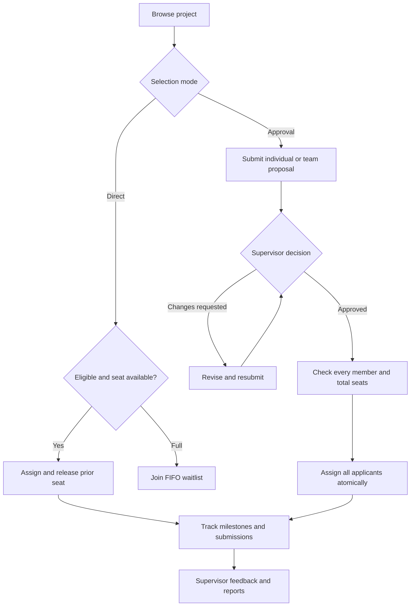

# ProjectPilot — Python Edition

**Version 3.0.1** · Academic project selection, applications and supervision

Originally written in **Java** as **ProjectSelectionManager**, then **converted to Python** and extended into this Tkinter/SQLite desktop application.

Maintained for **MEAZBAH MEHEDI** · [GitHub](https://github.com/MeazbahMehedi)

## What changed in 3.0.1

This release extends topic selection into a project application and supervision workflow.

| Area | 3.0.1 update |
| --- | --- |
| Administration | Create supervisor/student/admin accounts; enable/disable accounts; reset passwords; configure an inclusive selection period |
| Supervisor ownership | Supervisors manage only their own projects, applications, assigned/applicant students, milestones and submissions; administrators oversee all projects |
| Approval workflow | Individual or team proposals; approve, reject, request changes, revise and resubmit, or withdraw |
| Selection modes | New topics default to **Approval**. **Direct** topics retain immediate selection, atomic switching and FIFO waitlists |
| Teams | Student-created teams, invitation acceptance/decline, leader and member roles, one team proposal with a fixed applicant snapshot |
| Progress | Five default milestones per assignment, status tracking, completion percentage, custom supervisor milestones and due dates |
| Submissions | Repository/report links and local document attachments; supervisor feedback; Accepted or Changes requested decisions |
| Notifications | Invitations, application decisions, assignments, feedback, account changes and approaching deadlines; unread counter and mark-as-read |
| CSV imports | Read-only preview, hidden passwords, validation and all-or-nothing import; project and student templates |
| Original MySQL migration | Paired Projects/Students CSV migration preserving assignments and leading-zero student IDs; total capacity = remaining seats + assigned students |
| PDF reports | Project summaries, assignments, milestone progress and supervisor workload; paginated A4 output |
| Preferences | Theme, text size, window dimensions, project search, category and saved-topic filter persist per account |
| Interface | Selection-mode/status badges in tables, deadline countdowns, seat bars, inline form errors, unsaved-change prompts and save feedback |
| Accessibility | Adjustable text, visible native focus, Tab/Shift+Tab navigation, Ctrl+F search, Alt+1-9 page navigation and F5 refresh |
| Upgrade safety | Automatic same-edition 2.0 migration, pre-upgrade backup, preserved existing assignments and Direct selection behavior |
| Windows delivery | Installer recipe, application icon, PowerShell builder, desktop/start-menu shortcuts and a manual GitHub Actions build workflow |

**Windows installer status:** Source/build files are included. A prebuilt Windows `.exe` is not included in this ZIP because this release was built and checked on Linux. The Windows workflow is configured to bundle the runtime so the installed app can run without Python, Java or an IDE. See [the Windows build guide](docs/WINDOWS-INSTALLER.md).

## Quick start

Extract the entire ZIP into a writable directory, then open **START-WINDOWS.bat**. The Python source edition needs Python with Tkinter; the Java edition needs desktop Java 17+. The Java ZIP includes a runnable JAR. Neither edition needs MySQL.

| Demo role | Account ID | Password |
| --- | --- | --- |
| Administrator | `admin` | `DemoPass123!` |
| Supervisor | `teacher` | `DemoPass123!` |
| Student | `student` | `DemoPass123!` |
| Additional demo students | `student2`, `student3` | `DemoPass123!` |

The workspace starts with fictional topics and two example assignments. Use **Create student account** to register more students. Only an administrator can create supervisors or other administrators. Change demo passwords before entering real records.

When an old workspace already has an account named `admin`, migration creates a unique administrator ID instead of overwriting it. The login screen shows the bootstrap administrator ID.

## Roles and permissions

| Action | Student | Supervisor (`teacher`) | Admin |
| --- | --- | --- | --- |
| Browse topics | Published topics | Own topics | All topics |
| Apply / select / join waitlist | Own account or a leader's team proposal | — | — |
| Manage teams | Own team | — | — |
| Review applications and submissions | View own/team decisions | Own projects | All projects |
| Manage topics / add milestones | — | Own projects | All projects; may transfer ownership |
| Update milestone status | Own milestones | Own project students | All students |
| Read notifications | Own inbox | Own inbox | Own inbox |
| Read activity | Own actions | Own actions | All recorded actions |
| Import projects | — | Own ownership | Admin ownership; may transfer after import |
| Import students / migrate legacy data | — | — | Yes |
| Manage accounts / selection window | — | — | Yes |
| Full backup with attachments | — | — | Yes |
| Export reports | Own permitted records | Own project records | All permitted records |

## Daily workflow

1. **Admin:** create supervisor accounts, set the selection period, and transfer topic ownership where necessary. Blank start/end dates mean no date bound; Closed blocks new selections and approvals.
2. **Supervisor:** create a project with category, description, total seats, selection deadline and mode. Approval is the default for new topics.
3. **Student:** optionally create a team, invite classmates and wait for their acceptance. The team leader submits the proposal. Individual students can apply without a team.
4. **Supervisor:** open Applications, read the proposal, and approve, reject or request changes. A returned proposal can be revised by its original applicant.
5. **Assignment:** approval assigns every included applicant together or assigns nobody if any validation fails. The app creates Proposal, Development, Testing, Report and Presentation milestones.
6. **Student:** update milestone status and submit a document or code/report URL. For a requested revision, submit a new version so the earlier submission remains in history.
7. **Supervisor:** review the submission and leave feedback. Check the student/progress views or export a report.
8. **Everyone:** review their notification inbox. Admins periodically back up the workspace, including attachment files.



### Rules that protect the workflow

- One active assignment per student. A failed Direct-mode switch preserves the old assignment.
- Approval topics cannot be selected directly or entered through a waitlist. Waitlists belong to Direct topics only.
- Team applications snapshot their members. Membership changes are blocked while a member has an active application or assignment. A leader must wait for other members to leave before dissolving a team.
- Every approval applicant must be active and unassigned. A group must fit as a whole. A pending/returned application blocks Direct selection for its members.
- A student may withdraw their own application even outside the selection period. A waitlist member may leave a queue even while selection is closed. Existing students may still cancel assignments and submit work after selection closes.
- Default milestone due dates are 7, 28, 35, 42 and 49 days after assignment. Supervisors can add custom milestones for all currently assigned students on a project.
- Deadline notifications are generated/refreshed while the app is in use; no background email or operating-system notification service is claimed.
- Allowed attachments: PDF, DOCX, TXT, PNG, JPG/JPEG and ZIP, up to 20 MB. Files are copied into the workspace. The app saves attachment copies on request rather than executing uploaded files.
- The latest feedback is retained on each submission. A revised submission is a new record, keeping previous versions visible.

## Screenshots

All screenshots were regenerated from the running **3.0.1** application using temporary fictional demonstration data. The screenshot scenario includes a team proposal, one approved individual, milestone progress and reviewed work; fresh workspaces start with the simpler seed dataset.


<details>
<summary>Open the complete 14-screen gallery</summary>

### Sign in


### Projects and selection modes


### Applications and review


### Teams and member roles


### Milestones and progress


### Submissions and feedback


### Notification centre


### Account administration


### Imports and printable reports


### Light theme


### Saved preferences


### Student overview


### Supervisor student view


</details>

A standalone gallery is available in [docs/SCREENSHOTS.md](docs/SCREENSHOTS.md).

## Import and original-data migration

Open **Import & reports**. Supervisors can import projects. Admins can also import students or run **Legacy paired migration**.

- Project CSV: `title,supervisor,category,description,capacity,deadline,status,selection_mode`. Required: title and total capacity. Other omitted fields receive documented defaults; use the supplied template.
- Student CSV: `id,name,major,password`. Password can be omitted when a valid fallback initial password is supplied in the import dialog. Preview never displays password values. IDs must be unique and existing accounts cause the whole import to roll back.
- Imports validate the file before showing a preview. **Confirm import** is the write step. Correct an invalid file and preview it again.
- Legacy migration needs both old Projects and Students exports. The app validates references, computes total capacities correctly, creates student accounts with the supplied initial password and preserves selected-project relationships. New internal project IDs are mapped automatically.

See [docs/LEGACY-MAPPING.md](docs/LEGACY-MAPPING.md) and [CSV templates](docs/import-templates/README.md). No live connection to the original MySQL server is required.

## Reports, exports and backup

**Reports / Import & reports → Create PDF report** offers Project summary, Assignments and Progress. Supervisors/admins also get Workload. Reports follow the current role's access scope. Standard PDF fonts support Western/Latin text; unsupported Unicode characters may be replaced with `?`. CSV and JSON preserve Unicode and are preferable when complete multilingual names are required.

The project toolbar exports CSV or JSON. JSON includes permitted projects, student records, activity, applications, milestones and submission metadata, never password hashes or attachment bytes.

**Admin → Settings → Backup with attachments** creates a ZIP containing the database/JSON workspace and `attachments/`. Backups contain account hashes and student records; keep them private. To restore, close every app instance, keep a safety copy, and extract your backup's workspace file and attachments into the selected data directory. Restore a trusted backup as a unit; replacing only the database can leave attachment references missing.

Old 2.0 backups still restore in the matching language edition and migrate on first launch. Python SQLite workspaces and Java JSON workspaces are different formats; do not exchange their database files.

## Version history

| Release | Main changes |
| --- | --- |
| 1.0 | Original Java Swing/MySQL ProjectSelectionManager: projects, student selection, statistics and exports |
| 2.0.0 | Python rewrite and Java modernization; local storage, dashboard, accounts, search, themes, favorites and Direct waitlists |
| **3.0.1** | Administration, supervisor ownership, proposal review, teams, progress, document submissions, notifications, imports/migration, PDFs, saved preferences and Windows installer build files |

The original Java history remains documented in both named distributions. ProjectPilot and TopicNest are differently branded distributions of the same rewrite, with equivalent features. They are not presented as independent implementations.

## Python setup

**Runtime:** Python 3.10+ with Tkinter and SQLite. No pip packages are required to run the source application.

```powershell
py -3 main.py
```

```bash
python3 main.py
```

In PyCharm, open the extracted folder, choose a Python 3.10+ interpreter, and run `main.py`. On Debian/Ubuntu, install `python3-tk` if Tkinter is missing. A graphical desktop is required.

The source app stores data beside `main.py` in `data/workspace.db`. Installed Windows builds use `%LOCALAPPDATA%/ProjectPilot/Python/`. Choose another workspace with:

```bash
python3 main.py --data-dir /path/to/workspace
```

### Python architecture

| Layer | Files | Responsibility |
| --- | --- | --- |
| Entry | `main.py` | Runtime data location, Tk root and application launch |
| Core storage | `projectpilot/service.py` | SQLite initialization, parameterized queries, password hashing and original Direct workflow |
| 3.0.1 workflows | `projectpilot/advanced.py` | Schema migration, admin roles, ownership, teams, applications, milestones, submissions, imports and scoped reports |
| Presentation | `projectpilot/ui.py`, `projectpilot/advanced_ui.py` | Reusable controls plus current role-specific screens; no SQL in the UI |
| PDF output | `projectpilot/reports.py` | Paginated A4 reports, measured text wrapping and escaped PDF strings |
| Branding / seed | `projectpilot/config.py`, `projectpilot/seed.json` | Name, accent, maintainer and initial fictional topics |
| Verification | `tests/` | Core/advanced regressions and GUI workflow/screenshot runner |
| Windows packaging | `tools/`, `.github/workflows/` | PyInstaller runtime bundle plus Inno Setup installer recipe |

SQLite tables cover users, admin membership, projects, enrollments, favorites, waitlists, teams, invitations, application/member snapshots, tasks, submissions, notifications, settings and preferences. Write operations use `BEGIN IMMEDIATE`, commit and rollback. Group approval, assignment, notifications and milestone creation share a transaction. Constraints prevent duplicate assignments; foreign keys remove dependent project records. Unreferenced attachment files can remain after project deletion and are retained in full backups.

Passwords use salted PBKDF2-HMAC-SHA256 with 210,000 iterations. Read paths enforce current account state and effective role. CSV formulas are escaped on export. User data is local, not encrypted.

### Upgrade an existing Python 2.0 workspace

1. Close all old app instances and retain an independent copy of the old `data/` folder.
2. Extract this release into a new folder and copy the old `data/` folder beside its `main.py`, or point `--data-dir` at your chosen copy.
3. Start the app. It creates `workspace.pre-3.0.1.db` before changing an old schema, then adds the new tables and fields.
4. Existing topics retain **Direct** mode and are initially owned by `teacher`. Existing accounts, assignments and password hashes remain.
5. Sign in using the administrator ID shown on the login screen. Create the real supervisor accounts and transfer ownership through project editing as required.

### Run checks

```bash
python3 -m unittest discover -s tests -v
python3 -m tests.ui_smoke
```

The regression suite contains **45 tests**. GUI checks require a desktop display. To recreate screenshots, additionally install Pillow:

```bash
python3 -m pip install -r requirements-dev.txt
python3 -m tests.ui_smoke --out docs/screenshots
```

## Source layout

```text
ProjectPilot-Python/
├── main.py
├── projectpilot/                 # core, workflows, UI, reports, seed
├── tests/                    # regression and GUI/screenshot checks
├── docs/
│   ├── screenshots/          # 14 current 3.0.1 screens
│   ├── import-templates/
│   ├── WINDOWS-INSTALLER.md
│   ├── LEGACY-MAPPING.md
│   └── TESTING.md
├── assets/app.ico
├── tools/                    # Windows installer builders and recipe
├── .github/workflows/windows-installer.yml
├── START-WINDOWS.bat
├── BUILD-WINDOWS-INSTALLER.bat
├── CHANGELOG.md
└── README.md
```

## Practical limits and troubleshooting

- Run on a graphical desktop. Install Tkinter for Python or desktop Java 17+ for the Java edition if a display/runtime error appears.
- This is a local desktop application. It has no hosted portal, email verification, email password recovery or cross-device synchronization.
- The Java edition allows one process per data directory. Close the other instance if a workspace-lock message appears. Python writes serialize through SQLite; refresh other windows with F5.
- Use a writable local data directory. Do not hand-edit live workspace files or put real data, credentials, attachments or backups in a public repository.
- PDF output uses standard Western/Latin fonts; JSON and CSV preserve full Unicode. Submit code through a URL or ZIP attachment.
- UI fonts and native dialogs can vary by operating system. Windows scripts and installer recipes are supplied, but Windows execution is not claimed as tested here.
- Runtime data and build outputs are excluded by `.gitignore`. The Java executable JAR is intentionally included. Choose a repository license for your own code if you want to grant reuse rights; dependency licenses are kept separately.
