# ProjectPilot 3.0.1 — Python screenshots

Captured from the running app using temporary fictional data.

## Sign in

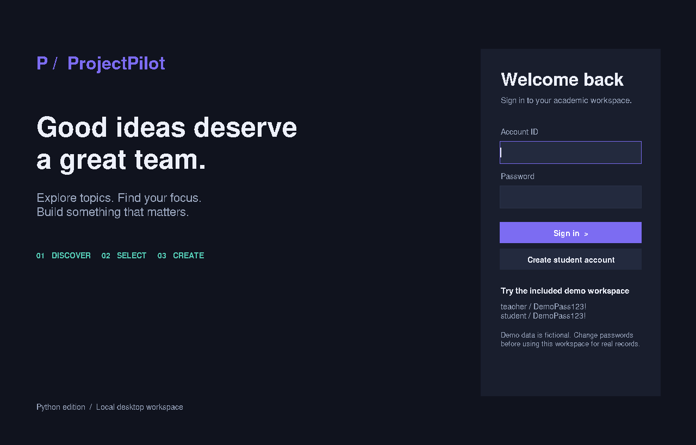

## Administrator overview

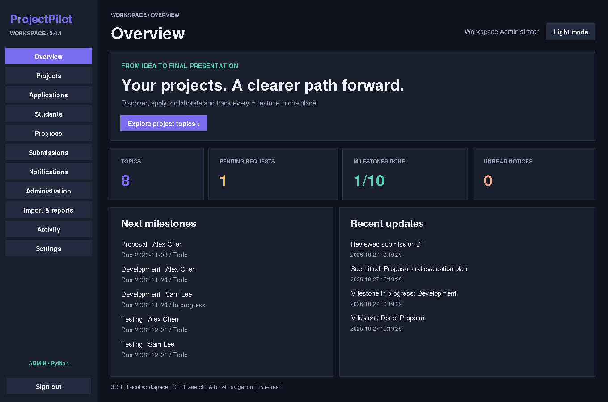

## Projects and selection modes

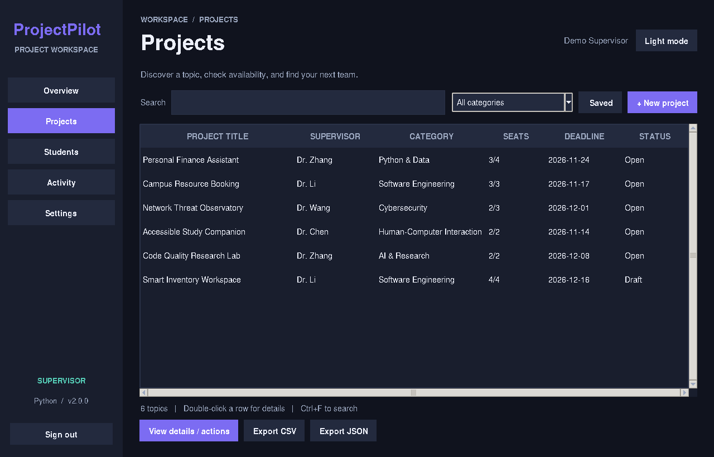

## Applications and review

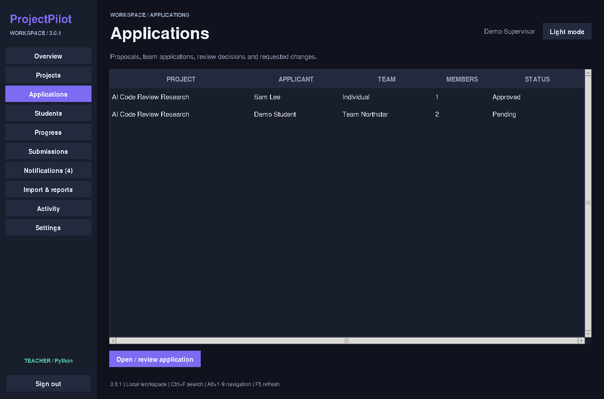

## Teams and member roles

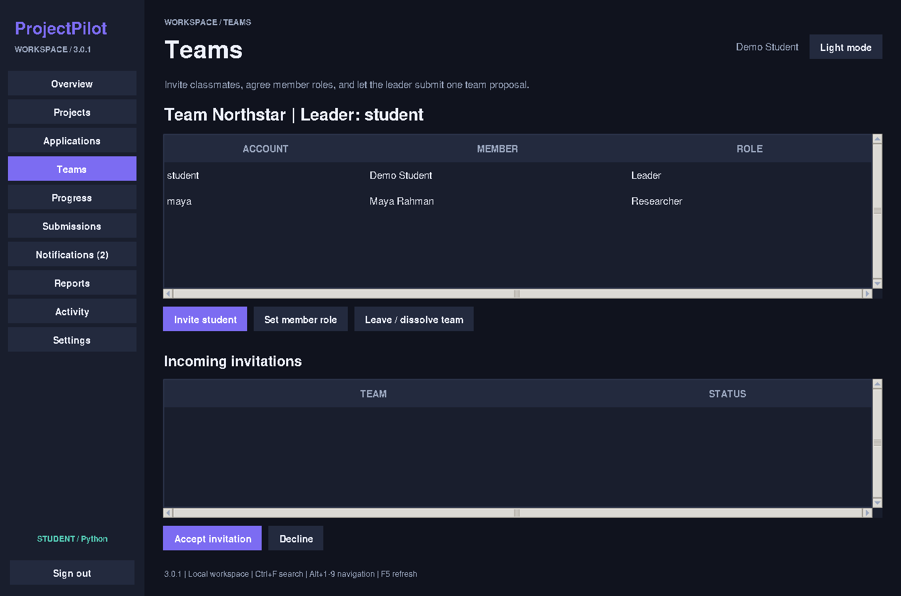

## Milestones and progress

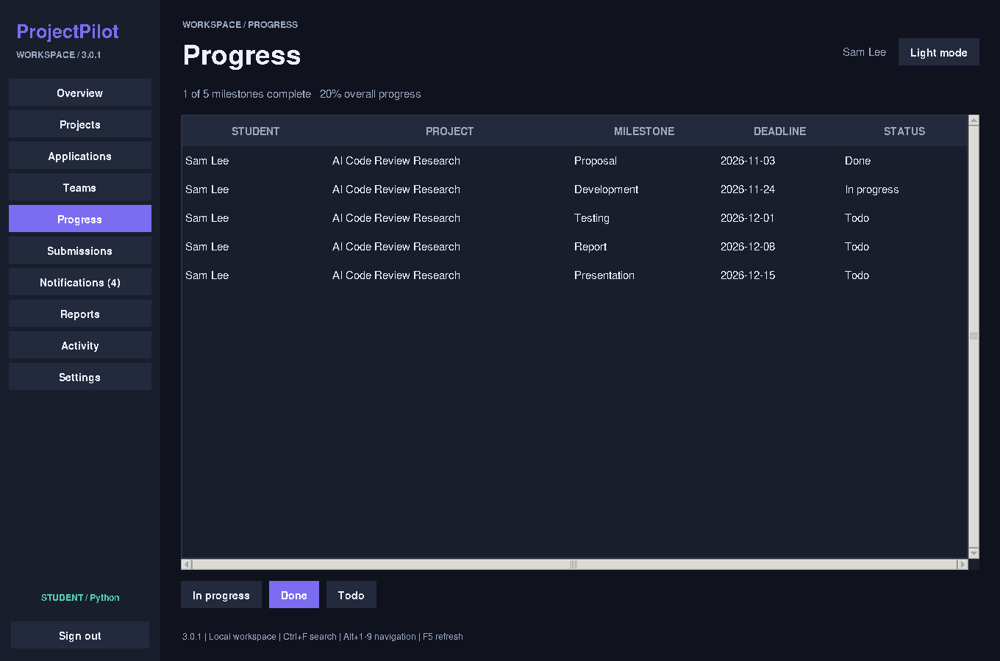

## Submissions and feedback

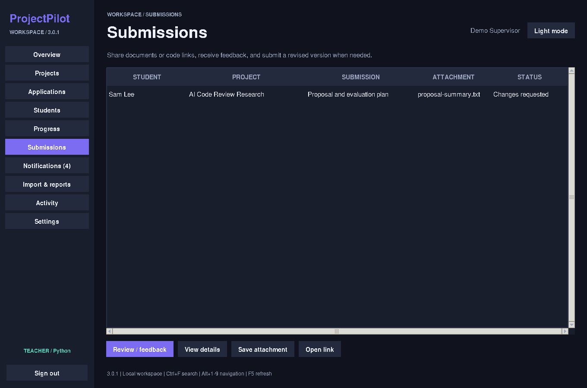

## Notification centre

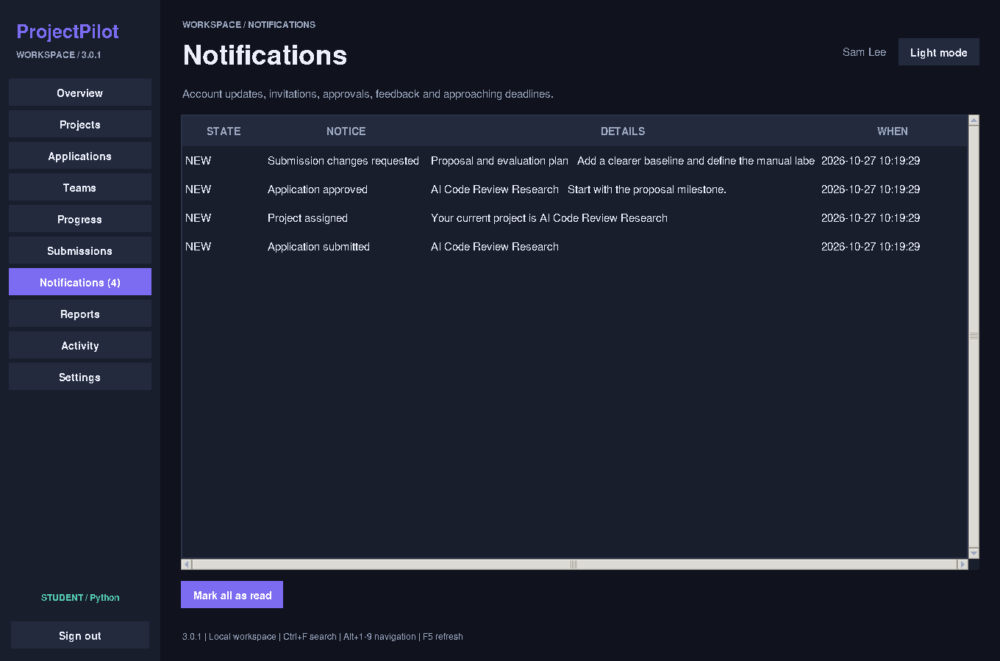

## Account administration

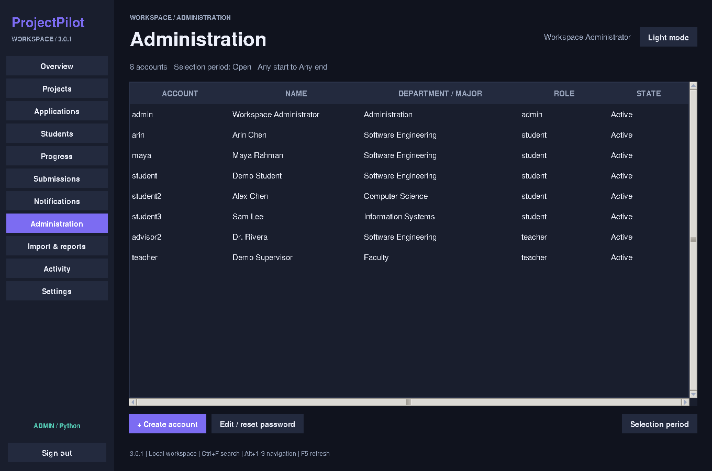

## Imports and printable reports

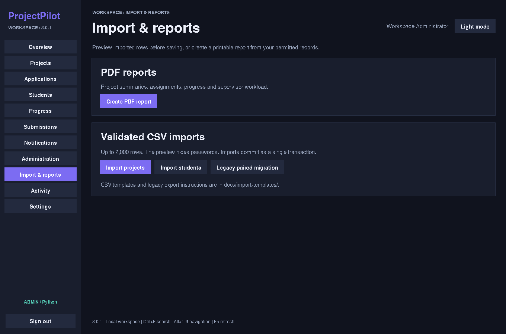

## Light theme

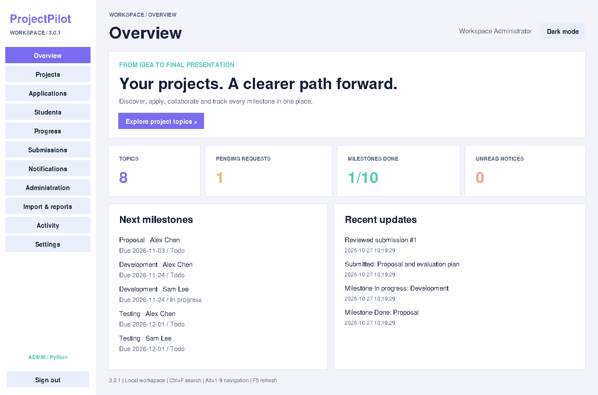

## Saved preferences

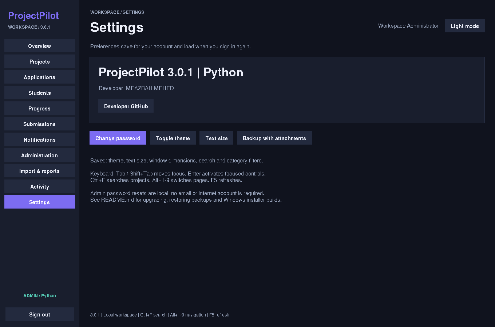

## Student overview

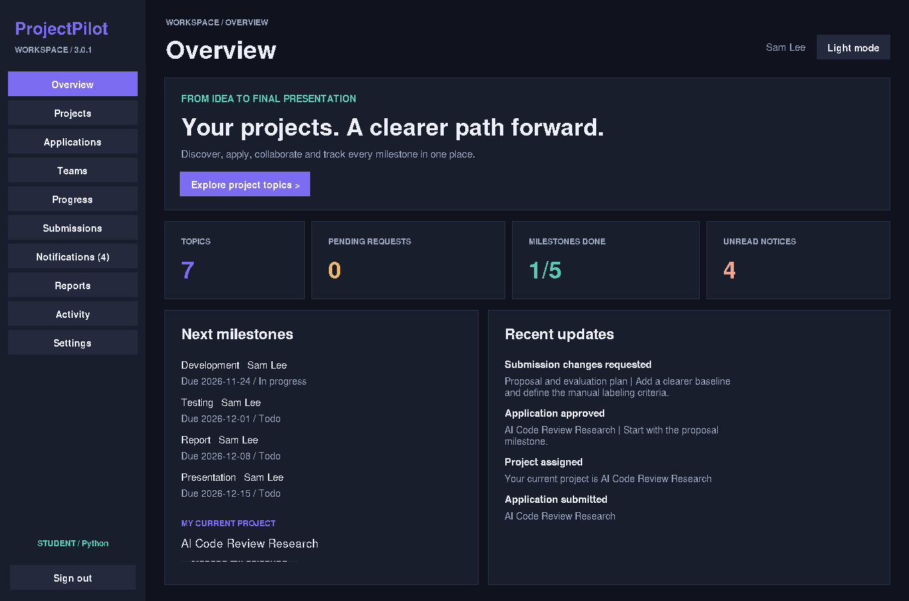

## Supervisor student view

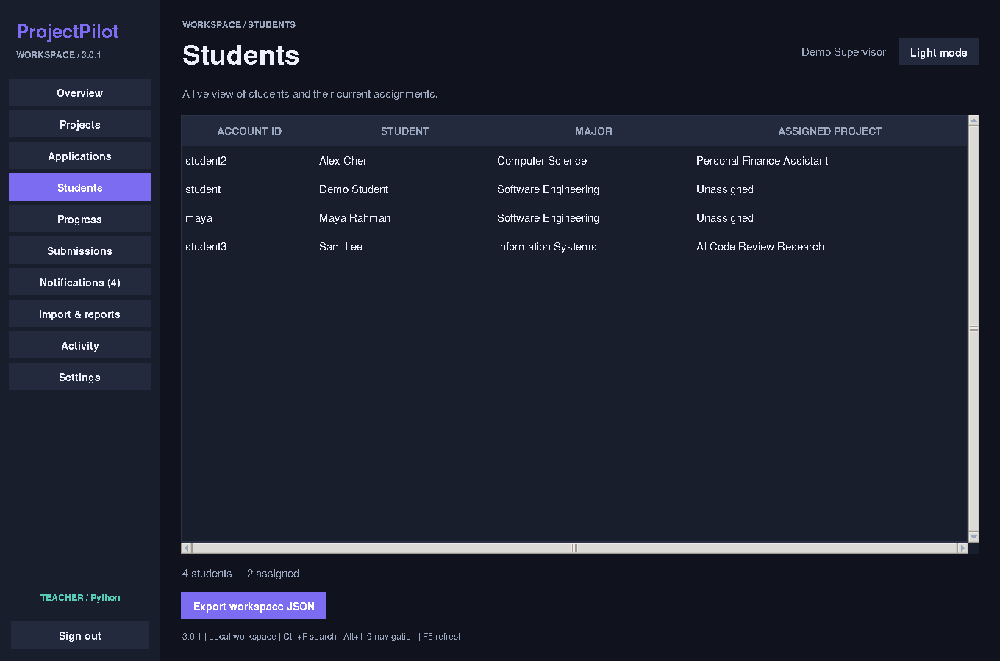